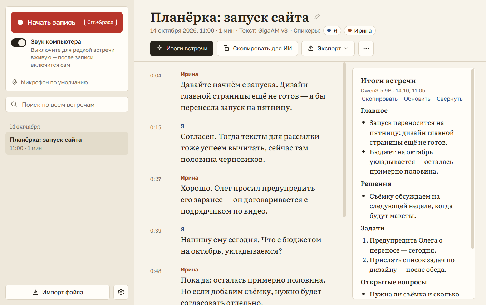

# TextMeet

TextMeet записывает встречи и созвоны (ваш микрофон и звук компьютера), превращает запись в текст с разбивкой по
собеседникам и пишет итоги — всё на вашем компьютере. Записи никуда не отправляются; интернет нужен только один раз,
чтобы скачать модели для расшифровки и итогов.



## Скачать

Установщики — на странице выпусков: [github.com/wiiProfaker/TextMeet/releases](https://github.com/wiiProfaker/TextMeet/releases).

- Windows — файл `TextMeet-Setup-<версия>.exe`.
- Mac — файл `TextMeet-<версия>-arm64.dmg`.

## Системные требования

- **Windows 10 или 11**, 64-разрядная.
- **Mac с процессором Apple** (M1 и новее), macOS 12 или новее.
- **Место на диске** под модели: для расшифровки — от 0,15 до 1,1 ГБ (стандартная модель Whisper от OpenAI — около 1 ГБ), для
  итогов — от 3 до 6,5 ГБ (стандартная Qwen3.5 9B — около 6 ГБ). Записи встреч занимают около 1 МБ на минуту.
- **Для итогов** нужна оперативная память: модели на 9–10 млрд параметров хорошо работают от 16 ГБ памяти (на
  компьютере с видеокартой — быстрее); на слабом компьютере выберите в настройках «ИИ» модель поменьше (Qwen3.5 4B).

## Установка на Windows

1. Скачайте `TextMeet-Setup-<версия>.exe` и запустите его.
2. Программа не подписана платным сертификатом, поэтому Windows может показать синее окно **«Система Windows защитила
   ваш компьютер»**. Нажмите **«Подробнее»**, затем **«Выполнить в любом случае»**.
3. Установка идёт сама, без вопросов; TextMeet откроется, когда закончится. Ярлык появится в меню «Пуск» и на
   рабочем столе.

## Установка на Mac

1. Скачайте `TextMeet-<версия>-arm64.dmg`, откройте его и перетащите TextMeet в папку **«Программы»**.
2. Откройте TextMeet из «Программ». Программа не подписана платным сертификатом Apple, поэтому при первом запуске
   macOS скажет, что не может проверить разработчика, и не откроет её — нажмите **«Готово»**.
3. Откройте **«Системные настройки» → «Конфиденциальность и безопасность»**, пролистайте вниз до сообщения о TextMeet
   и нажмите **«Всё равно открыть»**, затем подтвердите паролем или Touch ID. Это нужно сделать один раз.
4. При первой записи TextMeet попросит доступ к **микрофону** и к **записи звука компьютера** — разрешите оба.

**Если macOS пишет «Программа повреждена и не может быть открыта».** Так бывает с программами без платной подписи,
скачанными из интернета. Откройте программу «Терминал» (Программы → Утилиты), вставьте строку ниже и нажмите Return:

```bash
xattr -dr com.apple.quarantine /Applications/TextMeet.app
```

Эта строка ничего не меняет в программе — она лишь снимает с неё пометку «скачано из интернета». После этого
TextMeet откроется обычным образом.

## Первые шаги

1. **«Начать запись»** (или горячая клавиша: Ctrl+Space на Windows, ⌥ Space на Mac) — запись микрофона и звука
   компьютера.
2. **«Остановить запись»** — укажите, сколько было собеседников, или нажмите «Пропустить».
3. **«Расшифровать»** — в первый раз программа скачает модель расшифровки (Whisper, около 1 ГБ), дальше всё работает
   без интернета. Другую модель — например, GigaAM от Сбера, она точнее и быстрее на русском — можно выбрать в
   **Настройки → «Расшифровка»**.
4. **«Итоги встречи»** — модель для итогов скачивается в **Настройки → «ИИ»** (около 6 ГБ), один раз.
5. Готовый текст можно скопировать, сохранить в Word или в текстовый файл (**«Экспорт»**), а свои файлы записей —
   добавить кнопкой **«Импорт файла»** или перетащить в окно.

## Где лежат записи

Каждая встреча — отдельная папка в библиотеке: по умолчанию это папка **TextMeet** в вашей домашней папке
(Windows — `C:\Users\<имя>\TextMeet`, Mac — `/Users/<имя>/TextMeet`). Папку можно сменить в **Настройки →
«Общие»**. Модели лежат отдельно: Windows — `%LOCALAPPDATA%\TextMeet\models`, Mac — `~/Library/Application
Support/TextMeet/models`.

## Как удалить программу

- **Windows:** «Параметры» → «Приложения» → «Установленные приложения» → TextMeet → «Удалить».
- **Mac:** перетащите TextMeet из «Программ» в Корзину.

Ваши записи при этом остаются в библиотеке. Если они больше не нужны, удалите папку библиотеки сами; модели — папку
моделей (см. выше).

## Обновления

Новая версия ставится поверх старой: скачайте и запустите новый установщик (на Mac — замените программу в
«Программах»). Записи и настройки сохраняются. Когда страница выпусков доступна, TextMeet раз в день проверяет, не
вышла ли новая версия, и показывает внизу слева строку «Вышла версия…» со ссылкой; проверку можно выключить в
**Настройки → «Общие»**.

## Лицензии

TextMeet собран из открытых программ и шрифтов, модели скачиваются со страниц их авторов. Полный список с лицензиями —
в файле [THIRD-PARTY-NOTICES.txt](THIRD-PARTY-NOTICES.txt) (в программе — **Настройки → «Общие» → «Лицензии»**).

## Для разработчиков

Нужны Node.js 24 и npm.

```bash
npm ci
```

```bash
npm run dev
```

Проверки: `npm run typecheck`, `npm test` (модульные), `npm run e2e` (сквозные, Playwright), `npm run test:llm`
(настоящая модель итогов, только локально). Сборка: `npm run dist:win` (установщик Windows в `release/`) или
`npm run dist:mac` (на Mac; `.dmg` собирает GitHub Actions — `.github/workflows/build.yml`). Значки — `npm run icons`,
список лицензий — `npm run notices`. Спецификация и планы — в `docs/superpowers/`.
